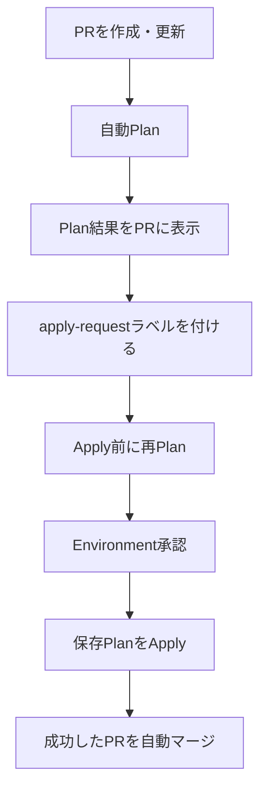
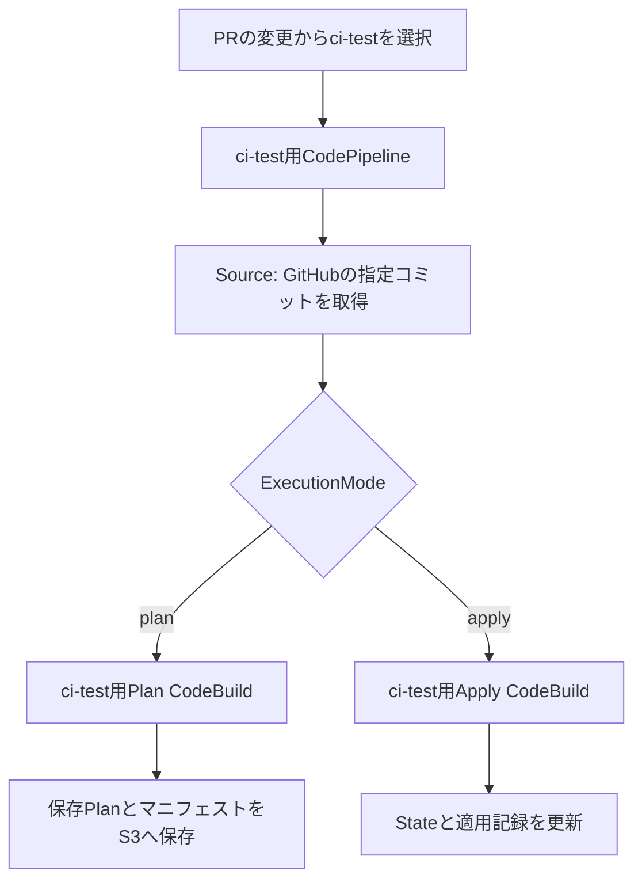
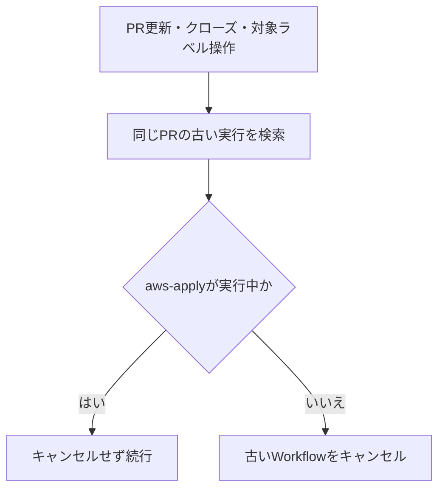

# Terraform CI/CD PoC 説明資料

## この資料について

このPoCでは、PR作成時にPlanを実行し、担当者がApplyを依頼した後に再Plan・Applyを行います。すべてのApplyが成功すると、対象PRを自動マージします。

> ここに記載したのはPoCの実装です。本番の閉域環境やプライベートリポジトリへ導入する場合の追加要件は、「本番環境へ展開する前の確認」に記載しています。

## 1. まず全体像

GitHub Actionsは、PRの確認、AWS認証、CodePipelineの起動、結果の確認を担当します。Terraformの実行はAWS CodeBuildが行い、CodePipelineがソースコードと実行ステージをつなぎます。

| 用語     | このPoCでの意味                                          |
| -------- | -------------------------------------------------------- |
| Plan     | AWSリソースを変更せず、変更予定を計算する                |
| 保存Plan | 再Planで作成し、Applyで再利用するPlanファイル            |
| Apply    | 保存Planに基づいてAWSリソースを変更する                  |
| Root     | 個別のTerraform実行単位。独立したStateを持つディレクトリ |

## 2. トリガー条件

### Planワークフロー

対象は `.github/workflows/terraform-plan.yml` です。

| PRのイベント                    | 動作                       |
| ------------------------------- | -------------------------- |
| 作成（`opened`）                | Planを開始                 |
| 更新（`synchronize`）           | 最新コミットでPlanを再実行 |
| 再オープン（`reopened`）        | Planを開始                 |
| Draft解除（`ready_for_review`） | Planを開始                 |

イベント対象は `main` 向けPRです。さらに `inspect` ジョブの条件で、同じリポジトリ内のPRに限定しています。フォークからのPRは、このジョブの対象外です。

### Applyワークフロー

対象は `.github/workflows/terraform-apply.yml` です。起動イベントは複数ありますが、Apply前の確認へ進むのは `apply-request` ラベルを**追加したとき**だけです。

| イベント                   | 動作                                                      |
| -------------------------- | --------------------------------------------------------- |
| `apply-request` ラベル追加 | 古い実行を整理してApply前の確認へ進む                     |
| PR更新、クローズ           | 古い実行のキャンセルを試みる                              |
| `apply-request` ラベル削除 | 古い実行のキャンセルを試みる。Apply確認ジョブは開始しない |

### `pull_request_target`を使う理由

両ワークフローは `pull_request_target` を使います。PRのコードに含まれる設定ではなく、ベース側の信頼できるWorkflowと制御スクリプトで動き、必要なGitHub API権限やAWS OIDC認証を使うためです。

このイベントでは権限やSecretsを利用できるため、PRの未信頼コードを特権ジョブ上で直接実行しないことが重要です。このPoCでは、制御スクリプトはbase SHAから取得し、Terraformコードは静的チェック用の別ディレクトリに取得します。静的チェックにはAWS認証情報を渡しません。CodeBuild側でも、Terraform実行前にPRとコミットを検証します。

### Applyを手動入力ではなくラベルで依頼する理由

PRに `apply-request` ラベルを付ける操作を、Apply依頼として扱います。PR番号を手動入力する方式と比べ、別PRの番号を誤入力する可能性を下げられます。イベントからPR番号とコミットSHAを取得するため、依頼対象もPRに結び付きます。

ラベルだけで直ちにAWS変更が始まるわけではありません。コードでは、ラベルを付けた人とWorkflowを起動した人の書き込み権限、現在のPR状態、成功済みPlanなども確認します。さらに `aws-apply` ジョブはGitHub Environment `terraform-apply` を使用します。承認者や許可ブランチの設定は、GitHub側のEnvironment設定で管理します。

## 3. Workflowが動く順番

### PR作成・更新後の自動Plan

`.github/workflows/terraform-plan.yml` は、次の順に処理します。

| 順番 | Job                   | 内容                                                                             |
| ---: | --------------------- | -------------------------------------------------------------------------------- |
|    1 | `inspect`             | PR状態、コミット、変更ファイル、対象Rootを確認。PRにPlan実行中のステータスを登録 |
|    2 | `static-checks`       | PRのTerraformコードに`fmt`、`init -backend=false`、`validate`を実行。AWS認証なし |
|    3 | `aws-plan`            | Plan用OIDCロールを引き受け、対象RootごとにCodePipelineを起動・監視               |
|    4 | `publish-plan-status` | PRの正確なhead SHAにPlanの成功・失敗を登録                                       |

### Apply依頼後の処理

`.github/workflows/terraform-apply.yml` は、ラベル追加からマージまで次の順で動きます。

| 順番 | Job               | 内容                                                     |
| ---: | ----------------- | -------------------------------------------------------- |
|    1 | `cancel-obsolete` | 同じPRの古いWorkflow実行を調べ、条件に応じてキャンセル   |
|    2 | `inspect`         | ラベル付与者、PR状態、成功済みPlan、対象Rootを確認       |
|    3 | `static-checks`   | Apply前にもPRコードを静的チェック                        |
|    4 | `aws-replan`      | Plan用ロールで再Planし、Planファイルとマニフェストを保存 |
|    5 | `aws-apply`       | GitHub Environmentの保護ルールを通過後、保存PlanをApply  |
|    6 | `merge`           | Apply成功とPR状態を再確認してからPRをマージ              |

## 4. 1 Rootと1 Pipelineの関係

例として、`terraform/env/poc/ci-test/` を1つのRootとします。このRootに対して、CodePipelineが1本作られます。

| 構成要素            | `ci-test`の例                                 |
| ------------------- | --------------------------------------------- |
| Rootディレクトリ    | `terraform/env/poc/ci-test/`                  |
| Pipeline名          | `<TF_PIPELINE_NAME_PREFIX>-ci-test-apply`     |
| Pipeline            | Source、Plan、Applyの各ステージ               |
| Terraform State key | `terraform/env/poc/ci-test/terraform.tfstate` |
| CodeBuild           | Plan用とApply用で分離                         |

`infra-cicd-apply/_data.tf` が対象Root一覧を作り、`codepipeline.tf` とCodeBuild設定が `for_each` でRootごとのリソースを作成します。`infra-cicd-*` 自身は対象Rootから除外されています。

変更ファイルから実際にPlan対象を決めるルールは次のとおりです。

| 変更箇所                                       | Plan対象             |
| ---------------------------------------------- | -------------------- |
| `terraform/env/poc/<root>/`                    | 変更されたRoot       |
| `modules/`、`terraform/modules/`、`buildspec/` | 登録済みの全Root     |
| `infra-cicd-*` や許可外のパス                  | 自動実行を失敗させる |
| 一部のREADME                                   | 対象外               |

### GitHubとAWS間の認証・接続

| 仕組み                              | 役割                                                                                            |
| ----------------------------------- | ----------------------------------------------------------------------------------------------- |
| GitHub OIDC                         | GitHub ActionsからAWS IAMロールを引き受ける。CodePipeline起動、状態取得、ログ・成果物確認に使う |
| CodeConnections（GitHub App）       | CodePipelineがGitHubからソースを取得する                                                        |
| CodePipeline / CodeBuildのIAMロール | PipelineとBuildがAWSサービス、State、Plan成果物を操作する                                       |

OIDCとCodeConnectionsは別の接続です。**OIDCはGitHub ActionsからAWS APIを呼ぶため、CodeConnectionsはCodePipelineがソースを取得するため**に使います。PipelineのSourceでは自動検出を無効化し、Actionsから指定したコミットSHAを取得します。

## 5. CodePipelineのPlan／Applyモード

PipelineにはPlanとApplyの両方のステージがあります。起動時に `ExecutionMode` 変数を渡し、ステージ入口の `VariableCheck` で一致しない側をスキップします。

| 起動元                        | Pipeline変数          | 実行するステージ |
| ----------------------------- | --------------------- | ---------------- |
| 自動PlanまたはApply前の再Plan | `ExecutionMode=plan`  | Plan             |
| Applyジョブ                   | `ExecutionMode=apply` | Apply            |

モードごとにPipelineを2本用意せず、Rootごとに共通Pipelineを使うことで、Source取得、成果物保管、実行状態の取得を共通化しています。一方、Plan用・Apply用CodeBuildプロジェクトとIAM権限は分離しています。CodeBuildでは `EXECUTION_MODE` とプロジェクト固有の `BUILD_MODE` も照合し、不一致ならTerraform処理を拒否します。

## 6. Applyが実行される条件

Applyは、以下の確認を順に通過する必要があります。

| 確認         | 内容                                                                                   |
| ------------ | -------------------------------------------------------------------------------------- |
| 起動イベント | `main` 向けPRに `apply-request` ラベルを追加したイベント                               |
| 操作者       | ラベル付与者とWorkflow起動者が`write`以上の権限を持つ                                  |
| PR           | オープン中、Draftでない、同一リポジトリ、`main`向け、マージ可能                        |
| コミット     | PRのhead/baseがイベント時点と一致し、baseが現在の`main`と一致                          |
| Plan         | 同じhead/baseに対する`terraform-plan.yml`の成功ステータスがある                        |
| 静的チェック | `fmt`、`init -backend=false`、`validate`が成功                                         |
| ラベル       | Apply開始時と対象Rootごとの処理前にラベルが残っている                                  |
| 再Plan       | Apply依頼時に再Planが成功し、対象RootすべてのPlan成果物がある                          |
| Environment  | `terraform-apply`の保護ルールを満たす。承認要否はGitHub側設定による                    |
| 成果物       | PR・Root・実行IDにひも付くS3マニフェスト、バージョン、チェックサムが一致し、有効期限内 |
| 排他         | 同じRepositoryの`aws-apply`は同時に複数実行しない                                      |

CodeBuildはApply直前にもPR状態を確認し、保存PlanのS3バージョンとSHA-256を照合してから、そのPlanファイルを`terraform apply`に渡します。Apply時に新しいPlanを作成するのではなく、承認対象となった保存Planを使います。

## 7. 自動マージの条件

`merge` Jobは `inspect` と `aws-apply` が成功した場合に実行されます。`aws-apply` は全対象Rootの成功確認後にのみ、適用したhead/base SHAを出力します。

マージ直前には、PRが開いていること、対象ブランチとhead/base SHAが変わっていないこと、`apply-request` ラベルが残っていること、PRのマージ状態が `clean` または `unstable` であること、同じhead/baseのPlan成功があることを再確認します。GitHub APIにはhead SHAを指定してマージを依頼するため、別コミットへのすり替わりを防ぎます。

## 8. Workflow重複時・ラベル解除時のキャンセル

`cancel-obsolete` は、同じPRを対象とする過去の `terraform-apply.yml` 実行をGitHub APIで探します。PR更新・クローズ、または `apply-request` の追加・削除時に動作します。

| 状況                             | 現在の動作                                                               |
| -------------------------------- | ------------------------------------------------------------------------ |
| PR更新・クローズ                 | 同じPRの古いWorkflowを検索してキャンセルを試みる                         |
| `apply-request`削除              | 古いWorkflowを検索してキャンセルを試みる。新しいApply確認は開始しない    |
| `aws-apply`が実行中              | そのWorkflowはキャンセル対象から除外                                     |
| Apply完了後、後続のmergeが実行中 | Workflow全体がまだ実行中なら、古い実行としてキャンセルされる可能性がある |
| AWS側Pipelineがすでに開始済み    | GitHub WorkflowのキャンセルだけではAWS処理のロールバックを保証しない     |

別に `aws-apply` JobにはRepository単位のConcurrency設定があり、Apply同士を直列化します。これは古いWorkflowを探して止める `cancel-obsolete` とは別の制御です。

`cancel-obsolete` は操作者の権限確認より先に動きます。権限のない操作で古い実行がキャンセルされないようにするには、Job条件やラベル操作権限も含めて別途確認が必要です。

## 9. 運用の流れと確認先

1. `main`向けPRを作成し、Planステータスが成功するまで待ちます。
2. GitHub Actions Summaryで変更RootとPlan内容を確認します。
3. Applyする場合、権限のある担当者が `apply-request` ラベルを付けます。
4. 再Plan Summaryを確認し、必要なEnvironment承認を行います。
5. Applyの結果を確認します。全Rootが成功するとPRは自動マージされます。
6. 失敗時はActionsのJob、CodePipeline実行、CodeBuildのCloudWatch Logs、必要に応じてS3の`diagnostics/`を確認します。

Plan成果物のマニフェスト有効期間は24時間です。複数Rootを順にApplyするため、後続Rootが失敗した場合でも先行Rootの変更は戻りません。AWSの実状態を確認してから再Planしてください。

## 10. 本番環境へ展開する前の確認

本番環境が閉域でプライベートリポジトリの場合、PoCをそのまま適用できるとは限りません。

- CodeBuildのGitHub API呼び出しは現在の実装では認証ヘッダーを付けていません。プライベートリポジトリに適した最小権限の認証方式を追加します。
- BuildspecはTerraformを`releases.hashicorp.com`から取得します。`terraform init`もproviderやmoduleを外部から取得する場合があります。閉域環境用のミラー、Proxy、接続経路を設計します。
- GitHub-hosted runner、CodeConnections、CodeBuild、S3、CloudWatch Logsそれぞれの通信経路を確認します。
- OIDCの信頼条件、GitHub EnvironmentのRequired reviewers、許可ブランチ、ブランチ保護を本番運用に合わせて設定します。
- Plan用・Apply用IAMロール、State・Plan成果物・診断ログへのアクセス範囲と保持期間をレビューします。

## 11. コード確認時点の注意

確認対象コミットの `.github/scripts/terraform_plan.sh` では、`prepare_plan` のSummary作成時に `${roots[*]}` を参照しています。一方、`roots` は `select_targets` 内のローカル変数です。スクリプトは `set -u` を指定しているため、Summary作成時に未定義変数エラーとなる可能性があります。サンプルを実行・提供する前に、対象一覧を保持している `targets_json` などを使う形に修正し、Workflow実行で確認してください。

## 主な構成ファイル

| ファイル                                                           | 役割                                                 |
| ------------------------------------------------------------------ | ---------------------------------------------------- |
| `.github/workflows/terraform-plan.yml`                             | PR自動PlanのトリガーとJob構成                        |
| `.github/workflows/terraform-apply.yml`                            | ラベル起点Apply、キャンセル、承認後Apply、自動マージ |
| `.github/scripts/terraform_plan.sh`                                | PR検査、対象Root選択、Plan起動、Plan結果検証         |
| `.github/scripts/terraform_apply.sh`                               | Apply依頼検査、Apply起動、適用後マージ               |
| `terraform/env/poc/infra-cicd-apply/codepipeline.tf`               | Rootごとの共通Plan／Apply Pipeline                   |
| `terraform/env/poc/infra-cicd-apply/codebuild.tf`                  | Apply用CodeBuildとRootごとのState設定                |
| `terraform/env/poc/infra-cicd-apply/buildspec/terraform_runner.py` | CodeBuild内でのPlan／保存Plan Apply                  |
| `terraform/env/poc/infra-cicd-plan/`                               | Plan用IAM・CodeBuildなどの定義                       |
